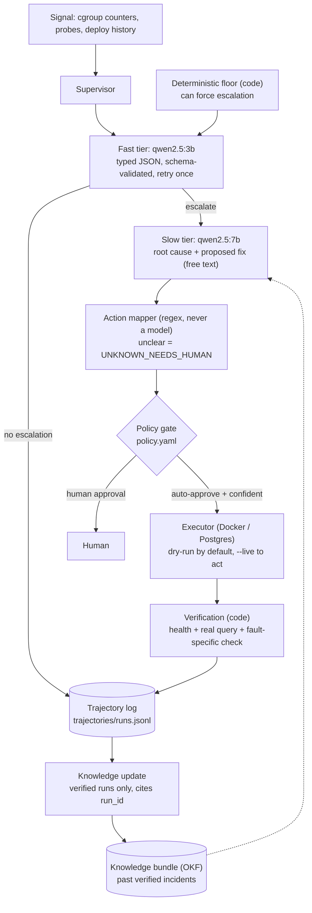
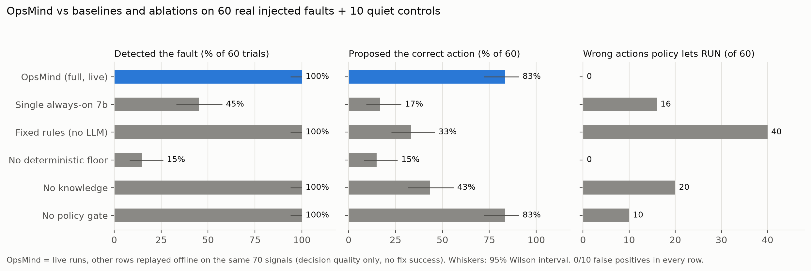
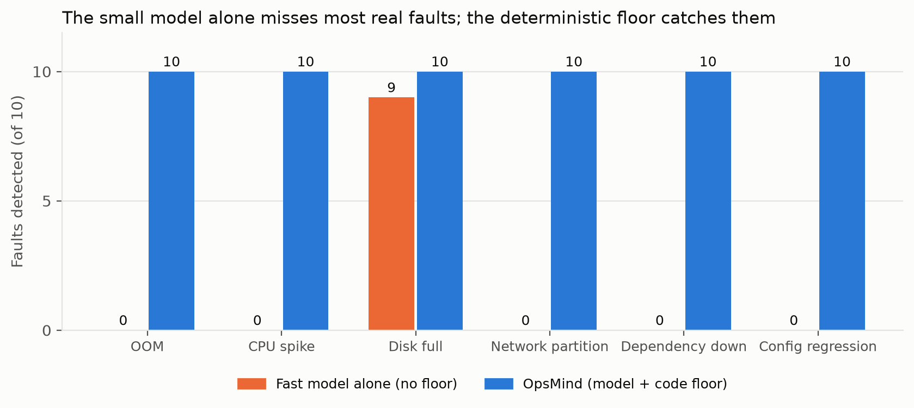

# OpsMind: an agentic engine for autonomous incident response

OpsMind watches a running service, detects a real incident, decides how serious it is,
diagnoses the cause, maps the proposed fix to a fixed set of safe actions, checks a policy,
executes the fix only if the policy allows it, verifies with code that the fix really worked,
and records everything in a replayable log and an evidence-linked knowledge base.

Everything is free and local: Ollama models, Docker, Postgres, Python. No paid APIs.

**The rule the whole design follows:** the language model never invents a fact and never makes
a safety-critical decision alone. Escalation has a deterministic code floor, action choice goes
through a rule-based mapper and a policy gate, and "did the fix work?" is answered by a code
health check, never by asking a model.

## Architecture



The test for "agentic, not just automation": does what the system finds change what it does
next? Here the fast tier decides whether anything happens at all, the diagnosis decides which
action is proposed, the policy decides auto-execute or human, and verification decides whether
the incident is closed.

## The six faults

Each fault is injected for real (the target service itself hits a real limit or a real failure):

| Fault | How it is injected | Auto-fixable action |
|---|---|---|
| OOM kill | memory-hungry SQL query against a 256 MB container | no (human: raise memory limit) |
| CPU spike | unindexed cross join against a 0.5-core cap | no (human) |
| Disk full | fills a 96 MB capped data volume until Postgres returns a real ENOSPC | no (human: deleting data is never automatic) |
| Network partition | `docker network disconnect` | `RECONNECT_NETWORK` |
| Dependency down | `docker stop` of Postgres; the web app stays up but unhealthy | `RESTART_DEPENDENCY` |
| Config regression | a bad config pushed through the real deploy tool | `ROLLBACK_CONFIG` |

## Setup

Requirements: Docker Desktop, Python 3.11, [Ollama](https://ollama.com) (the app must be running).

macOS / Linux:
```bash
python3.11 -m venv .venv && source .venv/bin/activate
pip install -r requirements.txt
ollama pull qwen2.5:3b && ollama pull qwen2.5:7b
docker compose -f services/docker-compose.yml up -d --build
```

Windows (PowerShell): same, except activate with `.venv\Scripts\Activate.ps1`.
The project was first built on Windows and re-verified on macOS (Apple Silicon); the Windows
path has not been re-run since the move.

`services/.env` holds local-only development credentials for the throwaway Postgres container
and is committed on purpose so a fresh clone works. Do not reuse those values anywhere real.
Run all commands from the repo root.

Check the setup without Docker or Ollama: `python -m unittest discover tests`

## Demo

1. Start the supervisor, which samples the service for a window (default 30 s):
   ```bash
   python agents/supervisor.py            # dry run: proposes and gates, executes nothing
   ```
2. In a second shell, inject a fault inside that window:
   ```bash
   python faults/network_partition.py --hold
   ```
3. Watch the supervisor detect it, diagnose it, map it to `RECONNECT_NETWORK`, and check the policy.
   Add `--live` to the supervisor to let it actually apply an auto-approved fix, then verify it.
4. Clean up held faults with `--clear` (for example `python faults/network_partition.py --clear`).
5. Open the dashboard: `streamlit run dashboard/app.py`

Other injectors: `faults/oom.py`, `faults/cpu_spike.py`, `faults/disk_full.py`,
`faults/dependency_down.py`, `faults/config_regression.py` (`--variant port|host`).

## Dashboard

`streamlit run dashboard/app.py` opens a read-only view with three tabs: incident runs with a
step-by-step trajectory viewer (signal, what the model said against what was decided,
diagnosis, mapped action, execution, verification), the evaluation tables and figures, and the
knowledge bundle. Every number on it is computed in code from the files.

## Results

Full configuration run live on real injected faults: 10 trials for each of the 6 faults, plus 10
quiet controls, with success judged by an independent ground truth (`eval/ground_truth.py`).
Full tables are in `eval/results/`; the notes there list every limit.

| Measure | Result |
|---|---|
| Detection (real incidents found) | 60 / 60 |
| Detection by the model alone, without the code floor | 9 / 60 |
| False positives on quiet controls | 0 / 10 |
| Auto-fixes that recovered the service (network, dependency, config) | 30 / 30 |
| Verifier false passes | 0 / 30 |
| Proposal mapped to the correct action | 50 / 60 (all 10 misses are CPU) |

Comparison on the same 70 saved signals (decision quality only; offline runs execute nothing):

| Configuration | Recall | Correct action | Wrong actions policy would let run |
|---|---|---|---|
| OpsMind (full) | 60/60 | 50/60 | 0 |
| Single always-on 7b model | 27/60 | 10/60 | 16 |
| Fixed rules, no LLM (restart-first) | 60/60 | 20/60 | 40 |
| Without the floor | 9/60 | 9/60 | 0 |
| Without knowledge | 60/60 | 26/60 | 20 |




### Findings, including the unflattering ones

- The small fast model alone detects only 15% of real incidents. The deterministic floor is
  what makes detection work.
- For CPU spikes the slow tier diagnoses correctly, but in the evaluation it proposed "increase the
  memory limit" 10 out of 10 times because its menu had no CPU item. Adding "increase the CPU
  limit" to the menu changed that to 10/10 CPU proposals in a replay (other faults unchanged), still
  blocked for a human by policy. The scored ground truth for CPU is still "terminate the query", and
  the headline numbers below were measured before this change (see `eval/results/cpu_menu_NOTES.md`).
- The slow tier's proposal depends on what its plain-language menu offers, and the prompt is
  fragile. A standing regression check (`python eval/slow_tier_regression.py`) replays real
  incidents through it and must be run after any change to the slow tier, prompt, or knowledge.
- Giving the slow tier past verified incidents lifted correct-action accuracy from 43% to 83%.
  It also follows precedent, so a wrong match would copy a wrong remedy. The code withholds
  the knowledge unless the signal matches exactly one fault type.

- Fault-specific verification matters: on held faults (config, disk) a plain "container healthy +
  SELECT 1" check wrongly passed while the fault-specific check correctly rejected (2/4 vs 0/4,
  n=1 per fault; see `eval/results/verification_wrong_fix_NOTES.md`).

### Limits

n=10 per fault, one machine, one model pair, temperature 0. The knowledge bundle was learned
from development runs of the same faults, so generalisation to new fault variants is only
lightly tested (one variant, n=3). Offline configurations cannot show whether a fix works.
OOM, CPU and disk fixes are human-only, so recovery is not measured for them.

## Repository layout

```
agents/       supervisor, fast tier, slow tier, action mapper
tools/        executor, deploy tool, knowledge writer
verify/       deterministic health checks
faults/       one injector per fault type
services/     target Postgres + Flask app (docker compose)
knowledge/    OKF bundle (markdown + YAML frontmatter), written only by code
policy.yaml   what may run without a human
trajectories/ replayable JSON log of every run
eval/         evaluation, baselines, ablations, regression gate, results
dashboard/    read-only Streamlit dashboard
tests/        unit tests, including one that fails if any floor is weakened
```

Run the full evaluation (about 35 minutes, needs Ollama and Docker, injects real faults):
```bash
python eval/run_eval.py && python eval/run_baselines.py && python eval/summarize_eval.py --compare && python eval/make_charts.py
```
