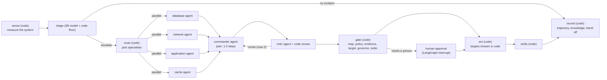

# OpsMind v2 architecture: a multi-agent graph with code-held decisions

## The design in one paragraph

Several language-model agents investigate an incident, and deterministic code decides what
happens. A router written in code picks which specialist agents to send. Each specialist
(database, network, application, cache) investigates only its own component, with its own
read-only tools, and must cite the tool results behind its finding. A commander agent turns the
findings into a plan of one or two steps, and a critic agent reviews it. Code then checks the
plan: does every broken component have a step, does each step act on the component it claims to
fix, is the action allowed, is there evidence, is there a real target, and has the same fix
already been tried too often? Only then does code act, and code checks the result. Every step
is streamed to a live console.

## Why this shape (what the literature says)

- **Free agents fail most operations tasks.** On ITBench (ICML 2025), agents built on frontier
  models resolved 11.4% of SRE scenarios. Letting a model act freely is not the state of the art;
  constraining it is.
- **Structure beats free-form ReAct for root-cause analysis.** Flow-of-Action (WWW 2025) reports
  that free ReAct agents take irrelevant actions because they hallucinate. Its fix is standard
  operating procedures plus a team of agents, which raised accuracy from 35.5% to 64.0%. mABC and
  RCAFlow also use multi-agent designs with fixed workflows.
- **Workflows before agents.** Anthropic's "Building effective agents" (Dec 2024) recommends the
  simplest pattern that works, with code-defined paths where they suffice.
- **Our own v1 data.** A single tool-using agent did better on unseen faults and worse on known
  ones, because it got lost in irrelevant evidence (`eval/results/novel_NOTES.md`).

OpsMind v2 follows these: narrow specialists with checklists (Flow-of-Action's SOPs), a
deterministic router (workflow, not free delegation), and code-held decisions (ITBench's
lesson). The checklists are generic diagnostic procedures per component, never fault answers.

## The graph



| Node | Kind | What it decides | Implemented in |
|---|---|---|---|
| sense | code | the measured facts | `fast_tier.collect_signal` |
| triage | 3B model + code floor | is this an incident? (the floor can force yes) | `fast_tier.classify` |
| route | code | which specialists to dispatch, from the facts | `graph.route` |
| specialists | 7B agents, parallel | is MY component broken, with cited evidence | `specialists.py` |
| commander | 7B agent | root cause and a 1-2 step plan | `graph.commander` |
| critic | 7B agent + code | approve or send back (code objections cannot be overruled) | `graph.critic`, `coverage_objections` |
| gate | code | per step: auto, needs a person, or refused | `graph.gate` |
| approval | human | approve or reject steps the code would not run | `graph.approval` (interrupt) |
| act | code | runs approved steps, lower layers first, with an evidence snapshot | `graph.act` |
| verify | code | did the system recover (fault-specific probes) | `verify/health_check.py` |
| close | code | trajectory line per step, knowledge write, hand-off queue | `graph.close` |

## The guards, and the failure each one answers

| Guard | Rule (all code) | Failure it prevents (where we saw it) |
|---|---|---|
| Escalation floor | measured fault conditions force escalation | 3B model missed 60 of 70 real faults |
| Fact scoping | a specialist sees only its own component's measurements | database agent called a healthy DB faulty after reading the app's error (live, compound fault) |
| Evidence grounding | "faulty" without citing a real tool result becomes "unknown" | invented findings |
| Coverage review | every grounded faulty cause needs a step; a step's action must act on its component | commander ignored a stopped cache; labelled a network fix as the cache fix (live) |
| Code beats critic | a code objection forces revision even if the critic model approves | critic model approved a plan that ignored a grounded finding (live) |
| Action mapper | free text maps to a fixed action set; unclear means a person | invented or compound actions |
| Policy | per action: automatic or human, with a confidence floor | risky actions (limits, deletion) |
| Evidence gate | an automatic action needs a grounded faulty finding for its component | acting on a hunch |
| Target check | executors choose targets from real state; nothing to do means refused | restarting a healthy container |
| Governor | no repeat of a failed fix, at most 2 identical fixes per 30 min, kill switch, deploy freeze | restart loops (AWS DynamoDB outage, Oct 2025) |
| Step order | dependencies and networks before config rollback | a correct rollback judged "failed" while the cache was still down (live) |
| Verification | fault-specific probes, fail closed, never a model | plain health checks pass while the fault persists |

## What runs where

- `opsgraph/` the graph (LangGraph `StateGraph`, `Send` for parallel specialists, `interrupt` for
  human approval, `InMemorySaver` checkpointing so a paused run resumes exactly where it stopped).
- `console/` FastAPI server and a single-page console (no build step, works offline). Live runs
  and recorded runs are drawn by the same code from the same event files
  (`trajectories/graph/<run_id>.jsonl`), so a demo can always fall back to a replay.
- `agents/`, `tools/`, `verify/` the v1 components, reused unchanged by the graph: the fast tier
  and floor, the mapper, the policy, the governor, the executors, the verifier, the knowledge layer.

## How to run

```bash
python -m console.server          # then open http://127.0.0.1:8765
python -m opsgraph.run            # one dry run from the terminal
python -m opsgraph.run --live --hitl
```

## Sources

- ITBench: Jha et al., ICML 2025, https://proceedings.mlr.press/v267/jha25a.html
- Flow-of-Action: Pei et al., WWW Companion 2025, https://arxiv.org/abs/2502.08224
- mABC: https://arxiv.org/abs/2404.12135
- Building effective agents: Schluntz and Zhang, Anthropic, Dec 2024, https://www.anthropic.com/research/building-effective-agents
- AWS DynamoDB post-event summary, Oct 2025, https://aws.amazon.com/message/101925/
